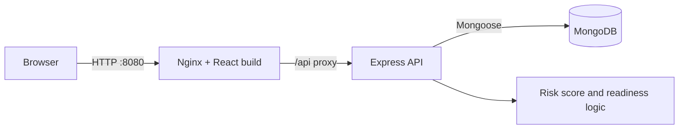
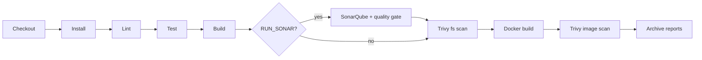

# SafeFlow Lite — Safety Project Tracker

A small full-stack app for tracking safety requirements, hazards and tasks, with a release-readiness gate that blocks release while critical hazards are unresolved or required verification is incomplete. The check runs in the backend (`GET /api/readiness`) and the dashboard displays its result.

## Features
- **Dashboard:** total requirements, open hazards, completed tasks, verification pass rate, risk distribution chart, recent activity, release readiness.
- **Requirements:** add, edit, delete, search and filter by status and priority.
- **Hazard Register:** add, edit, resolve, delete. Risk score = severity × likelihood: 1–4 Low, 5–9 Medium, 10–16 High, 17–25 Critical.
- **Tasks:** To Do / In Progress / Done board with create, edit, delete and move.
- All metrics are computed from MongoDB data. No authentication (out of scope).

## Technology stack
React + Vite, Tailwind CSS, Lucide, Recharts · Node.js, Express, Mongoose, Helmet, CORS · MongoDB · Docker Compose · Jenkins, SonarQube, Trivy · Terraform (AWS EC2).

## Local setup (without Docker)
Requires Node 20+ and a running MongoDB.
```bash
cd backend && cp .env.example .env && npm install && npm run seed && npm run dev
# second terminal
cd frontend && npm install && npm run dev     # http://localhost:5173 (proxies /api to :5000)
```
Checks: `npm run lint`, `npm test`, `npm run build` in each of `backend/` and `frontend/`.
Run `npm install` once per folder and commit the generated `package-lock.json` files so Docker and Jenkins use `npm ci`.

## Docker
```bash
cp .env.example .env
docker compose up -d --build
docker compose exec backend npm run seed     # safe to repeat: no duplicates
```
Open http://localhost:8080. Health: `curl http://localhost:8080/api/health`. Stop: `docker compose down` (add `-v` to delete data).
MongoDB is not published to the host and runs without authentication, which is acceptable for a local demo only.

## Jenkins setup
Jenkins needs: Docker and Trivy installed on the agent; the user running Jenkins in the `docker` group.
- **Plugins:** Pipeline, Git, NodeJS, SonarQube Scanner, Timestamper.
- **Global tools:** NodeJS named `node22` (version 22); SonarQube Scanner named `sonar-scanner`.
- **SonarQube (optional):** Manage Jenkins → System → SonarQube servers → name `sonarqube`, with a server URL and a "Secret text" token credential. Add a webhook in SonarQube to `<jenkins>/sonarqube-webhook/`. Then build with `RUN_SONAR` ticked.
- Create a Pipeline job from SCM pointing at this repo. Lint, test and scan failures fail the build; Trivy reports are archived from `reports/`.

## SonarQube and Trivy commands
```bash
sonar-scanner -Dsonar.host.url=http://localhost:9000 -Dsonar.token=$SONAR_TOKEN
trivy fs --scanners vuln,secret,misconfig --severity HIGH,CRITICAL .
trivy image --severity HIGH,CRITICAL safeflow-backend:local
```
Record real results in `docs/vulnerability-report-template.md`. Scan results are not included in this repository.

## Terraform / AWS (EC2)
Creates one `t3.micro` instance and a security group (HTTP from a CIDR you choose, SSH off unless you set `ssh_cidr`). The instance installs Docker, clones your repo (it must be reachable over HTTPS) and runs `docker compose up`. Nothing is created until you run `apply`.
```bash
export AWS_ACCESS_KEY_ID=... AWS_SECRET_ACCESS_KEY=...   # or use AWS_PROFILE
cd terraform
cp terraform.tfvars.example terraform.tfvars              # set repo_url, tighten allowed_http_cidr
terraform init
terraform validate
terraform plan -out tfplan
terraform apply tfplan
terraform destroy                                         # removes everything and stops charges
```
Seed after the first boot (SSH needs `ssh_cidr` and `key_name`): `cd /opt/safeflow && sudo docker compose exec backend npm run seed`.
This serves plain HTTP with no database authentication. Add HTTPS and Mongo credentials before using real data.

## SDG 9 alignment
Supports SDG 9 (Industry, Innovation and Infrastructure) by helping engineering teams manage safety risk in the systems they build, make release decisions that are traceable and evidence-based, and apply automated quality and security checks (CI, static analysis, vulnerability scanning) to reliable software infrastructure.

## Architecture


## CI/CD workflow


## API
`/api/health` · `/api/requirements` · `/api/hazards` (+ `PATCH /:id/resolve`) · `/api/tasks` (all support GET, POST, PUT, DELETE) · `/api/readiness` · `/api/dashboard`
